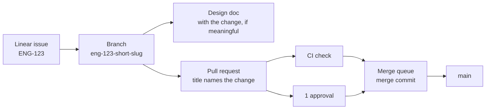

# Responding

- Lead with the answer. The first sentence answers the question or states the outcome.
- A yes/no question gets "Yes" or "No" as its first word. Qualify in the next sentence, never before it.
- Answer what was asked, and only that. No unrequested background, alternatives, caveats, next steps or offers.
- One to three lines by default, for every reply: answers, status reports and "done" messages alike. Longer needs a
  reason; expand only when asked ("explain", "why", "details", "walk me through").
- Short never means vague: being correct and unambiguous comes first. If the honest answer needs four lines, write
  four.
- Terse, plain language. No preamble, no restating the question, no closing recap, no filler.
- Name things. Never write "the file", "the fix" or "the check" while more than one could be meant; use its name.
- Say what you found, not how you found it: no log lines, command output, config keys or `file:line` unless they are
  the answer or were asked for.
- Use the reader's words, not the investigation's. After digging, restate the finding in plain terms.
- No preaching. No lectures on best practices, style, safety or ethics unless asked. A real problem gets one line.
- No hedging or softeners. State uncertainty once, briefly, where it matters.
- Prefer a list, table, command or code over prose when it is shorter, but put no headings, tables or lists on a reply
  of a line or two.
- Ambiguous request where the answer depends on the reading: ask one short question. Otherwise take the obvious
  reading and answer.
- No emojis, no exclamation marks, no marketing tone. Match the user's language.

Q: What does the `octomaton.dev/branches` annotation do?

- Good: It limits a ServiceAccount to runs from those branches.
- Bad: A section on tenant namespaces, a table of every ServiceAccount, and the history of the design.

Q: Why did the Docs check fail on this pull request?

- Good: A link points at a page that `delivery` renamed. Fix the link and the check passes.
- Bad: The `links` step of the `docs` PipelineRun exited 1 after `compose.py` overlaid six layers, and its log shows
  `unresolved` for `platform/docs/README.md` at line 214, so…

# Reporting work

- Say what changed and what is left, in a few lines. Skip the narrative of how you got there.
- Never omit a failure, a skipped step or a risk that affects correctness; one line each.

# Linear ticket links

- Write every Linear issue ID (e.g. ENG-123) as a Markdown link: [ENG-123](https://linear.app/arikkfir/issue/ENG-123).
  Every time, including in summaries, artifacts, lists and when describing commits.
- Exception: git and GitHub metadata keep the bare key. Commit messages, the pull request description's magic-word line
  and branch names use it as is (`Closes ENG-123`, `eng-123-short-slug`); commit subjects and pull request titles carry
  no key.

# House rules

<!-- CONTRIBUTING.md of arikkfir-org/docs, copied by scripts/house_rules.py of arikkfir-org/tooling: change it in docs, then run the script again. -->

Conventions for every repository in `arikkfir-org`, for humans and coding agents alike. Repository-specific rules live in each repository's `<REPO>_CONTRIBUTING.md`, `CLAUDE.md` and `README.md`; where they conflict with this page, the repository wins.

## Workflow



1. **Start from a Linear issue.** A trivial fix that has none carries the label `skip-linear` instead (see [Linear](#linear)).
2. **Branch** from the default branch using the issue's branch name.
3. **Write or update the design doc** for every meaningful unit of work, in the change's pull request (that repository's `docs/`), so it sits with its code (see
   [Design documents](#design-documents)).
4. **Open a pull request** early; mark it ready once CI is green and the description is complete.
5. **Merge through the merge queue**. Default branches accept merge commits only, after one approval, resolved conversations and green `Continuous Integration`, `Docs` and `Linear` checks. Nobody pushes directly to a default branch, `docs`'s included.

## Linear

| Team        | Key   | Scope                              |
|-------------|-------|------------------------------------|
| Engineering | `ENG` | Code, infrastructure, CI           |

- Reference issues by key: `ENG-123`. In every repository, GitHub links `ENG-` keys to the issue in Linear.
- Branch names come from Linear ("copy git branch name"): `eng-123-short-slug`. The key in the branch name links the
  pull request to the issue.
- Every pull request links its Linear issue, through its branch name or a magic word in its description. A pull request that has no issue (a dependency bump, a typo) carries the label `skip-linear` instead; Dependabot's carry it through their configuration. Check `Linear` passes a pull request once either is true, and runs again when its description or labels change.
- Pick the magic word by what is left of the issue. `Closes ENG-123` (or `Fixes`, `Resolves`) when this pull request finishes the issue, the usual case: the issue moves to done when the pull request merges. `Part of ENG-123` (or `Contributes to`, `Refs`) links without closing, only while more pull requests for the issue are still to come; the last of them says `Closes`.
- One pull request per issue where practical. Split large issues into sub-issues rather than sending one huge
  pull request; a task too large for one issue gets a project (see [Projects](#projects)).
- Do not put issue keys in commit subjects or pull request titles; the description carries them into the merge
  commit.

### Projects

A task too large for one issue, such as a feature delivered in several pull requests or a change across repositories, gets a Linear project ([design](https://docs.dev.kfirs.com/hub/designs/linear-projects.md)).

- **Suggest a project** for a large task. Agents propose one to their person, with its slices, and create it only once they agree.
- **One issue per slice**, in the project, however many pull requests the slice takes: each says `Part of` its issue, and the last says `Closes`. Prefer slices that are self-contained and deployable on their own: once its issue is done, a slice releases and runs without waiting for the next, and each of its pull requests leaves the default branch working.
- **Keep the project's status current** as its slices land, and post a project update for each milestone or significant change: what shipped, what is next and what is at risk, with the project's health (on track, at risk or off track).

### Writing an issue

The issue and the pull request each have one job. The issue says why something should change; the pull request says what changed and how. An issue may name the code path at fault, but it never designs the fix, and a pull request never re-argues why the change is needed. If the implementation ends up contradicting the issue, say so in the pull request and update the issue ([design](https://docs.dev.kfirs.com/hub/designs/writing-issues.md)).

- **Title**: a bug's title describes the wrong behaviour as it is today ("The argocd Application never reaches Synced"). Any other issue's title states the outcome it asks for, as it will be true once done ("infra plans every pull request and applies every merge to main").
- **Body**:

  ```markdown
  <Lead paragraph: the symptom or the ask, who it affects and what follows from it. Enough to act on, no file paths.>

  ## Evidence
  <Bugs, and maintenance a measurement motivates: what proves it's real (the failing check, the log line, the reproduction), and the code path at fault, named rather than redesigned.>

  ## Done when
  <What someone can observe without reading the diff.>
  ```

- **Priority**, set when the issue is filed:

  | Priority | When                                                                      |
  |----------|---------------------------------------------------------------------------|
  | Urgent   | Something is down, exploitable or losing data, and there is no workaround |
  | High     | It hurts, but there is a workaround                                       |
  | Medium   | Limited impact; planned work starts here                                  |
  | Low      | Cosmetic, internal or cleanup                                             |

  A security weakness or data loss is never below High.

## Commit messages

[Conventional Commits](https://www.conventionalcommits.org/en/v1.0.0/):

```text
<type>(<scope>)!: <summary>

<body: what and why, wrapped at 72 columns>

<footers>
```

- **type**: `feat`, `fix`, `docs`, `refactor`, `perf`, `test`, `build`, `ci`, `chore`, `revert`.
- **scope** (optional): the component touched, e.g. `feat(webhook): …`, `fix(gke): …`.
- **summary**: imperative mood ("add", not "added"), lower case, no trailing period, at most 72 characters.
- **body**: why the change is needed and what it does at a high level; not a list of files.
- **breaking changes**: `!` after the type/scope and a `BREAKING CHANGE: …` footer explaining the migration.
- **footers**: `Closes ENG-123`, `Co-authored-by: Name <email>` for whoever co-wrote the change, a person or a coding agent.
- Commits on a branch may be small, but they land on the default branch as they are, next to the merge commit, so
  each follows these rules and builds.

## Pull requests

**Title**: names the change the pull request makes, in the imperative and in sentence case, e.g. `Report skipped pipelines as skipped checks`. It becomes the merge commit's subject, so `git log --first-parent` reads as a list of what each merge did. No `type(scope):` prefix (that belongs to commit subjects, which keep it), no issue key and no emoji. GitHub ends the merge commit's subject with ` (#123)`, so keep the title within 65 characters for the subject to fit in 72.

**Description**: the merge commit's body. Use this structure:

```markdown
## Summary
What changes and why, in two or three sentences.

## Changes
- Notable changes, grouped logically.

## Testing
How it was verified: commands run, environments, screenshots.

## Design
Link to the design doc in arikkfir-org/docs (for meaningful work).

## Risks and rollout
What could break, how to roll back, manual steps (secrets, DNS, Terraform applies).

Closes ENG-123
```

- Keep pull requests small and focused; one concern per pull request.
- No pull request of documentation alone: documentation ships in the pull request whose changes it documents. The exceptions: `docs`'s own pull requests, whose changes are its pages, a pull request that moves a page into the repository it describes, which documents no change of its own, and a root-cause write-up that ships no fix, which describes what is.
- Draft while incomplete; ready for review only when CI is green.
- Every review conversation ends resolved: fixed, or answered with the reason it stays, then resolved by the reviewer (see [Answering a review](#answering-a-review)).
- Re-request review after addressing changes; stale approvals are dismissed on push.
- The author merges, through the merge queue.

### Answering a review

A round ends in this order: push the fixes, reply on every thread, then request the review again.

- **Reply on the thread**, in one line: `Done.` (naming the commit) when it's fixed, or one sentence on why it stays as it is.
- **Leave resolving to the reviewer.** A review thread is the reviewer's to resolve, once its fix or its answer satisfies them. The one exception: when the reviewer's latest review approved and left only non-blocking findings open, the author may resolve those threads to merge the pull request. For `arikkfir-reviewer` these are its 🔵 nits; its 🟡 non-blocking findings come with a request for changes, so the exception never covers them. Never resolve a blocking finding's thread, or the thread of a finding you fixed before the reviewer has reviewed the fix.
- **One reply at a time.** GitHub's secondary rate limit refuses replies fired at one repository in a burst, where the same replies spaced out go through. Post one, let it land, post the next. On a `403` that names the secondary limit, wait for `Retry-After` if it gives one, otherwise at least a minute, and wait longer each time it fails again ([GitHub's guidance](https://docs.github.com/en/rest/using-the-rest-api/rate-limits-for-the-rest-api#exceeding-the-rate-limit), which `reviewer/github.py` in `tooling` follows too).
- **Request the review again** once every thread has its answer. `arikkfir-reviewer` starts its next round only when asked, and a pull request whose reviewer was never asked to look again is stranded: nothing red, nothing blocking, and nobody aware it's their turn.
- **Agents reply through the GitHub connector** (`mcp__github__add_reply_to_pull_request_comment`), which writes as the developer. A raw `curl` to `api.github.com` from a cloud session is the last resort: the session's proxy replaces its credentials, so the reply is authored by `claude[bot]`. Say so in the session when you use it.

## Continuous integration

- CI is [Octomaton](https://github.com/arikkfir-org/octomaton) running Tekton pipelines declared in each repository's root `.octomaton.yaml`. There are no GitHub Actions workflows.
- Protected repositories require a check named `Continuous Integration` on pull requests and in the merge queue: the pipeline `ci` with that `displayName`. It must list `pull_request` and `merge_group` in its triggers.
- Every repository also requires check `Linear`, tooling's organization pipeline `linear`, which asks Linear whether an issue is linked to the pull request ([design](https://docs.dev.kfirs.com/tooling/designs/linear-check.md)). It passes merge groups without asking: their pull requests passed it to enter the queue.
- Every pipeline that checks pull requests runs on all of them, whatever their base branch: `pull_request` takes no `branches` filter. A pull request stacked on another branch is then checked before it reaches `main`, not only once the one below it merges.
- A red check is fixed, never bypassed: no skipped tests, no disabled checks, no empty commits to re-trigger. A flaky test is a bug; fix it or file it with a Linear issue.
- Pin every version: container images, Helm charts, Terraform providers, Go modules, tool versions. The one exception is the reviewer image, which `tooling` builds and runs at its `main` tag so that every merge that changes it reaches the next review.
- Every PipelineRun declares what each of its tasks needs, in `spec.taskRunSpecs[].computeResources`: CPU and memory requests and a memory limit, sized from real runs. Runs then land where there is room and the CI pool grows, instead of runs starving each other on one node. Set them on the task, not on its steps: the steps run one at a time in one pod, and Tekton reserves a task-level request once, while step requests add up. Leave CPU unlimited, so steps can use idle CPU.
- Tekton files (PipelineRun, Pipeline, Task, StepAction) are short and concise, composed from references rather than inlined. A PipelineRun references its Pipeline (`pipelineRef`), or its inline `pipelineSpec` its Tasks (`taskRef`), by name, each in a file of its own beside it (`<name>.pipeline.yaml`, `<name>.task.yaml`), which Octomaton inlines ([Tekton files](https://docs.dev.kfirs.com/octomaton/designs/tekton-files.md)); a step that Tasks share is a StepAction (`<name>.step.yaml`, the step's `ref`). A step names its command, or runs a script file of the pipeline's own repository, where a linter can check it; an inline `script` is a few lines of glue at most, such as the clone that fetches those files. An organization pipeline takes its scripts from `tooling`'s default branch, never from the repository it runs on. A change to a long, inlined file splits what it touches ([design](https://docs.dev.kfirs.com/tooling/designs/tekton-files.md)).

## Design documents

Every meaningful unit of work (a new component, a change of architecture, a new convention, anything someone will later ask "why is it like this?" about) gets a design document, written before or alongside the change and updated when the implementation diverges. It never gets a pull request of its own: it ships in the change's pull request, in that repository's `docs/`, so it sits and merges with the code it describes. Only a design with no code of its own goes to `docs`, in a pull request there.

- **Where**: in the repository the design is about, under its own directory of the site: `docs/<repository>/designs/<slug>.md` there. Every repository's `docs/` maps to the site root, so `docs/octomaton/designs/architecture.md` in `octomaton` is `octomaton/designs/architecture.md`. `docs` keeps only what is about no one repository: these house rules, the templates and the hub-wide designs ([design](https://docs.dev.kfirs.com/hub/designs/docs-ownership.md)). Rich visual pages may be HTML.
- **Across repositories**: split the design into one document per repository, each in the pull request of that repository's part, under the same slug in each repository's directory (`infra/designs/node-pools.md` and `delivery/designs/node-pools.md`): every repository's `docs/` composes into the one URL space at `docs.dev.kfirs.com` ([design](https://docs.dev.kfirs.com/hub/designs/docs-site-composition.md)), so the parts read as one design. Only a design that loses its value in parts stays whole, in the leading repository: the one whose change the others serve.
- **Links**: link a page by where it is on the docs site, never as "file X in repository Y". Inside a page, a relative link (`../../infra/terraform/gcp.md`); outside the site (a README, a `CLAUDE.md`, a code comment), its URL, `https://docs.dev.kfirs.com/<path>.md`. The `Docs` check resolves relative links against the other repositories' `main`, so a part links only to pages already merged or in its own pull request. Later parts link back to earlier ones.
- **Visual first**: at least one diagram (Mermaid in Markdown, or SVG/HTML) showing the moving parts.
- **Contents**: context and goal; the design; decisions with their rationale and rejected alternatives; security and failure modes; rollout and manual steps; open questions.
- **Facts in one place**: a name, address, identity or permission is documented by the repository that creates it, in its pages, and changes there with its code. Designs elsewhere link that page instead of copying it. A change to one starts in the repository that creates it, and the repositories that use it follow in the same unit of work. What `infra` provisions is described once, in its pages ([the Terraform roots](https://docs.dev.kfirs.com/infra/terraform/gcp.md)), and what runs in the cluster in `delivery`'s ([the hub platform](https://docs.dev.kfirs.com/delivery/platform.md)): another repository may list the resources it uses, its own included, and links those pages for the rest.
- Link the design from the pull request, and the pull request from the design once it exists.

## Investigations and walkthroughs

- An investigation ends in a root-cause write-up, whether or not it leads to a fix or an issue: [template](https://docs.dev.kfirs.com/hub/templates/root-cause.md).
- A pull request a reviewer can't follow from its diff gets a walkthrough, linked from its `## Summary`: [template](https://docs.dev.kfirs.com/hub/templates/walkthrough.md).
- Both use one visual vocabulary (diagrams over narration, tables over parallel lists, status markers, drill-downs): the [writing toolkit](https://docs.dev.kfirs.com/hub/templates/toolkit.md).
- A write-up lives in the repository at fault, under its `docs/<repository>/root-causes/`, in its fix's pull request when there is one; one about no one repository lives in `docs`. A walkthrough lives in `docs`, which is public, unless it's about an internal repository (`fin`): then it lives in that repository's own `docs/`, as private as its code ([design](https://docs.dev.kfirs.com/hub/designs/investigations-and-walkthroughs.md)).

## Code and configuration

- **Formatting**: use the language's canonical formatter (`gofmt`, `terraform fmt`, `prettier` where configured) and linter. CI enforces them.
- **Comments** explain why, not what, except that a doc comment first says what its symbol is for (see Go). No commented-out code; no TODO without a Linear key.
  - Leave code you didn't change alone: no new comments, docs or type annotations on it.
  - When a change touches part of a comment, change only the words whose meaning changed. Don't reflow or rewrap the rest of it: the churn buries the real change in the diff.
  - Wrap a new comment at the width of the comments around it, not at a narrower default such as 72 columns.
- **Tests** accompany behaviour changes. Bug fixes start with a failing test, in the same pull request as the fix, at the level where the bug lived: a bug in how Octomaton renders a PipelineRun gets a test of the rendered run, not only of the code beneath it.
  - Test application code only. Never write tests for CI/CD code or scripts, Kustomize, Helm, shell scripts, infrastructure code or developer-experience scripts.
- **Resource requests**: every container requests the CPU and memory it typically uses, as measured, and limits its memory above its peak, unless its runtime sizes itself to the limit (Java's heap). CPU stays unlimited, except for batch work that would starve its neighbours. The scheduler places pods, and the cluster autoscaler grows a pool, by requests only: a request below use packs a node past its CPU, one above use reserves room nobody uses, and a pod without requests is the first evicted. The hub's components: delivery's [resource requests](https://docs.dev.kfirs.com/delivery/designs/resource-requests.md); Fin's: [fin's](https://docs.dev.kfirs.com/fin/designs/resource-requests.md). CI tasks: [Continuous integration](#continuous-integration).
- **Infrastructure as code**: every cloud and cluster change goes through Terraform (`infra`) or Argo CD (`delivery`). Manual changes are for emergencies only and are back-ported to Git the same day.
- **Secrets** never enter Git. Values live in Google Secret Manager; External Secrets Operator syncs them into the cluster.
- **Least privilege**: grant the narrowest role on the narrowest resource to the narrowest identity (every grant: infra's [IAM](https://docs.dev.kfirs.com/infra/terraform/gcp.md#iam)). In CI, Tekton's default ServiceAccount `pipeline` never gets a Google Cloud role. A pipeline that needs one names its own ServiceAccount, and one that publishes runs only from `main`, or from version tags where a product releases versions (Octomaton's and Cobranch's `v*` tags, admitted by `octomaton.dev/tags` beside `octomaton.dev/branches`).
- **Names**: lower-case, hyphenated (`ingress-public`, `ci-docs`); labels and annotations use the `kfirs.com/` prefix. A product with a domain of its own uses that domain instead: Octomaton writes `octomaton.dev/` labels.
- **Less is more**: reuse what exists rather than duplicate it, unless there is a good reason not to.
- **Refactor to align**: when things need to line up, change the existing code. Don't build abstractions or scaffolding around it to avoid the risk of touching it.
- **The right thing, not the easy thing**, with some slack for urgency, or when the effort far outweighs the value.
- **Go**, **HTTP APIs**, **Databases**, **Messaging** and **Observability** below follow one [design](https://docs.dev.kfirs.com/hub/designs/service-conventions.md).
- **Go**:
  - Pass `ctx context.Context` first to every function that does I/O, blocks, or calls one that does; never store it in a struct.
  - Check every error, without exception. Logging an error isn't handling it, except at the top of the call stack, where the error is either logged once (which reports it to Error Reporting) or actually handled (another route taken).
  - Ignore an error only on purpose and in plain sight: assign it to `_` with a comment saying why, e.g. `_, _ = fmt.Fprintln(w, msg) // stdout is gone; nothing to tell`.
  - Wrap every error you return with what the function was doing and the key/values it knows, so the error carries its chain from the entry point down to the root cause, each link with its message, location and values. Compare errors with `errors.Is` and `errors.As`; sentinel errors stay plain `errors.New` values.
  - Start a span in every significant function, with the key/values that identify what it acts on as attributes, and carry them in the context, so the logs and errors beneath it name them too.
  - A function fits on one screen, about 60 lines, and handles at most a couple of concerns; the rest becomes named helpers.
  - Doc comments lead with what the symbol is for or what the function does, in one sentence that starts with its name; then why it's needed; then how it works; then who uses it, in general terms.
  - Write `any`, never `interface{}`.
  - Configure programs with [`envconfig`](https://github.com/kelseyhightower/envconfig) (environment variables), not command-line flags. Flags name only what a one-off command acts on: a tool's input, or what an operator asks a deployed binary through `kubectl exec`, which can pass it nothing else.
  - Log through `log/slog` only, and only through its `*Context` methods.
  - Layers: transports (HTTP handlers, message consumers) translate between the wire and domain calls and hold no business logic. Domain packages hold the logic, each behind one `Service` whose exported methods start a span and check authorization first. Generated storage code is used by domain packages only, and the one database wrapper alone builds its queries. Shared code specific to the product goes in `common`; code any project could use goes in `util`, which imports nothing of the product's.
  - golangci-lint runs errcheck, wrapcheck, contextcheck, sloglint (`context: all`), spancheck, depguard (the layers), funlen, gocognit and revive (`use-any`).
- **HTTP APIs**:
  - Version each route in its path (`/v1/…`). A new version holds only the routes that changed; the rest stay where they are. A superseded route answers with `Deprecation` (RFC 9745) and `Sunset` (RFC 8594).
  - The OpenAPI document is the contract: server interfaces and clients are generated from it, and CI fails on a breaking change within a version.
  - Authenticate every request with a JWT. Authorize with permissions, never roles, in the domain layer, denying by default.
  - GET reads: 200, or 304 when `If-None-Match` matches. POST creates (201 with `Location`) or starts work (202 with the `Location` of a status resource). PUT replaces and PATCH (`application/merge-patch+json`) changes: 200, or 202 when the work runs on. DELETE answers 204. HEAD comes with every GET.
  - Every resource has a strong `ETag`, and GETs send `Cache-Control: private, no-cache`. PUT, PATCH and DELETE require `If-Match`: 428 without it, 412 when it no longer matches.
  - Times travel as RFC 3339 in UTC, and clients show them in the viewer's time zone. A route that groups by day or month takes the viewer's zone as a parameter.
  - Errors are RFC 9457 `application/problem+json`, with a stable `type` URI and the trace id.
  - Lists page with an opaque cursor and `Link: rel="next"`.
- **Databases**:
  - Every access runs in a transaction, through one wrapper that sets the session's tenant, user and trace for row-level security and auditing; no code path gets a query handle any other way.
  - Points in time are `timestamptz`. Every row that gets updated has a `version`, bumped by a trigger, which is its ETag.
- **Messaging** (NATS JetStream):
  - Delivery is at least once, so every consumer is idempotent: by natural key, or through an inbox written in the same transaction as the effect.
  - An event that follows a database change goes through a transactional outbox and is published with `Nats-Msg-Id` set to the outbox row's id.
  - Messages have a schema in which a missing field differs from a zero, and CI fails on a breaking change to it.
  - Streams, consumers and buckets are declared with the deployment, never created by code.
  - Subjects put the tenant in a fixed token. Headers carry `traceparent` and `tracestate`, in lowercase.
  - A message that fails for good is terminated and recorded, never dropped silently.
- **Observability**:
  - Traces go to Cloud Trace, logs to Cloud Logging, errors to Error Reporting, metrics to Cloud Monitoring.
  - On GKE, logs are JSON lines with Cloud Logging's field names: `severity`, `message`, `timestamp`, `logging.googleapis.com/sourceLocation`, and `logging.googleapis.com/trace`, `logging.googleapis.com/spanId` and `logging.googleapis.com/trace_sampled`, which link a line to its trace. Elsewhere logs are text.
  - Spans: SERVER per HTTP route, INTERNAL per top-level domain method, CONSUMER per message, PRODUCER per publish, CLIENT per outbound call, the browser's requests included. End every span and record its error.
  - Every span carries `service.name`, `service.namespace` (the Kubernetes namespace), `service.version`, `deployment.environment.name`, the module, and `enduser.id` once a user is known. W3C `traceparent` crosses every tier, HTTP and NATS alike, and never leaves our own services.
  - A span attribute names what an operation acted on or how it ended, stays small, and is something you'd filter by. A span event marks a moment within it. A log entry narrates, repeats per item, must survive sampling, or is an error. Secrets go nowhere.
  - Calls to language models follow OpenTelemetry's GenAI conventions (`gen_ai.*`).
- **Shell**:
  - Start every script with `set -euo pipefail` (`set -eu` in POSIX `sh`).
  - Never let an exit code stand in for an answer. When a script needs to know something, ask for the data and branch three ways, failing on anything but the two answers you expect. `if cmd >/dev/null 2>&1` can't tell "no" from "the command broke":

    ```sh
    found="$(kubectl get applications -n argocd -o json | jq --arg name "$name" 'any(.items[]; .metadata.name == $name)')"
    case "$found" in
      true) echo "found $name" ;;
      false) echo "no $name yet" ;;
      *) echo "could not list Applications" >&2; exit 1 ;;
    esac
    ```

  - Tolerate a failure on purpose with `|| true` and a comment saying why, never with `2>/dev/null` alone: silencing stderr hides the failures you didn't expect along with the one you did.
  - A loop over many items carries on past a failure, counts the failures, and exits non-zero if there were any.
- **Markdown**:
  - Do not manually wrap text; let the Markdown viewer or renderers do it on their own.
  - Keep tables borders formatted.

A repository's own rules (its `CLAUDE.md` and `README.md`) come on top of these house rules and win where they conflict.
The [pull request reviewer](https://docs.dev.kfirs.com/tooling/designs/pr-reviewer.md) applies both.

## Releases

- Every push to an application's default branch releases it: the push publishes the application's image, tagged with the commit's short SHA, which is also the version the application reports. A release's notes are its merge commit: the pull request's title and description.
- A product other clusters host also has versions: a GitHub release, tag `v<version>` on a commit of the default branch, title `<version>`, GitHub's generated release notes (the pull requests since the previous version, with their authors) and a link to its installation guide at that tag. Publishing the release creates the tag, which publishes the images tagged with the version, and its Helm chart at that version if it has one; a draft has no tag and no effect. Octomaton and Cobranch are the ones so far ([Octomaton's versioned releases](https://docs.dev.kfirs.com/octomaton/designs/releases.md), [Cobranch's releases](https://docs.dev.kfirs.com/cobranch/designs/repository.md)); a person drafts and publishes the release on GitHub.
- Deploying a release is a pull request to `arikkfir-org/delivery` that bumps the pinned image tag. Octomaton's is a version: the bump sets its tag as both the manifests' revision and the images' tag ([hosting Octomaton](https://docs.dev.kfirs.com/delivery/designs/octomaton.md)). Fin and `cobranch.app` are the exceptions: Argo CD deploys their `main` with the images of the commit it syncs ([Fin's environments](https://docs.dev.kfirs.com/fin/designs/environments.md), [hosting cobranch.app](https://docs.dev.kfirs.com/delivery/designs/cobranch-app.md)).

## Coding agents

- Agents follow this page and the repository's `CLAUDE.md`.
- Agent-authored pull requests get the same review as any other: at least one human approval.
- Agents never apply Terraform, change the cluster directly, or push to a default branch.
- Agents add the label `skip-linear` to a pull request only when their person says so.
- **Attribution is allowed.** Agents may keep the attribution their environment adds: a `Requested by … · project thread` header, a `Generated with Claude Code` footer, a session link, `Co-Authored-By: Claude …` and `Claude-Session:` trailers. They need not edit out what a tool appends by itself ([design](https://docs.dev.kfirs.com/hub/designs/attribution.md)).
- Agents read pages of `https://docs.dev.kfirs.com`, which is behind the hub's sign-in, from their bucket, rather than cloning repositories: `curl -fsS https://storage.googleapis.com/arikkfir-docs/.layers/<repository>/<path>`, where `<repository>` is the path's first segment when it names a repository, and `docs` otherwise ([Claude Code cluster and docs access](https://docs.dev.kfirs.com/tooling/designs/claude-code-cluster-access.md#docs)).
