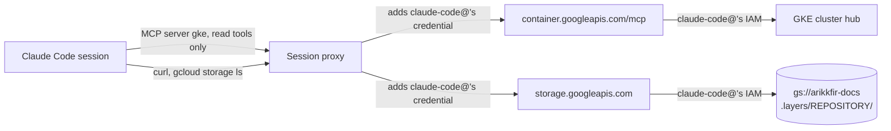

# Claude Code cluster and docs access

Claude Code on the web sessions read the hub cluster, its objects, events and pod logs, through GKE's remote MCP server, and the docs site's pages from the docs bucket, as service account `claude-code@`. Sessions never get a kubeconfig, nothing they run changes the cluster or the docs, and they read every repository's docs without cloning it. This repository's bundle declares the MCP server and the permissions of its tools ([Claude Code tooling](phase-5-tooling.md)); `infra` holds the identity and its roles ([root gcp](../../infra/terraform/gcp.md)). Built with ENG-69 (the cluster) and ENG-127 (the docs).

## Why

A session diagnosed a deployment from the outside only: when `https://fin.kfirs.com` answered 404, it could tell that Traefik had no route, but not whether Argo CD had created Application `go-import`, or what stopped it.

kubectl can't reach the cluster from a session. The cluster answers only on its DNS-based endpoint (`*.gke.goog`), and the sessions' proxy adds the Google credential only to requests for `*.googleapis.com`. gcloud has no login of its own in a session either. GKE's remote MCP server, `https://container.googleapis.com/mcp`, is under `*.googleapis.com`, so the credential the proxy already adds authenticates it, and nothing is left to configure in a session.

A session in one repository that needed another's docs had to clone that repository: `https://docs.dev.kfirs.com` is behind the hub's sign-in, which a session can't pass. The docs site's pages are files in a bucket, and `storage.googleapis.com` is under `*.googleapis.com` too: the proxy adds this credential to a session's requests there as well.

## Design



| Piece | Value |
| --- | --- |
| Identity | `claude-code@arikkfir.iam.gserviceaccount.com`, made by hand and adopted by `infra`'s `terraform/gcp`; the Claude Code environment holds its key, made by hand, and its proxy adds it to requests for `*.googleapis.com` ([bootstrap](../../infra/runbooks/bootstrap.md), step 12) |
| Roles (`infra`'s `terraform/gcp`) | `roles/viewer`: reads the project, the cluster's objects and pod logs included, but no Kubernetes Secret or Secret Manager payload, and changes nothing. `roles/mcp.toolUser`: calls Google's MCP servers' tools. `roles/storage.objectViewer` on bucket `arikkfir-docs`: lists and reads the docs site's layers |
| MCP server | `gke`, `https://container.googleapis.com/mcp`, in `claude/mcp.json`, at user scope in every session |
| Without a prompt | its read tools, allowed in `claude/settings.json`: `get_*`, `list_*`, `describe_*` and `check_*` |
| Denied | its write tools, denied there: `apply_*`, `patch_*`, `delete_*`, `create_*`, `update_*` and `cancel_*`, which IAM refuses as well. `tests/test_settings.py` checks each of the server's tools against both lists |

### Docs

A page at `https://docs.dev.kfirs.com/X` is the object `.layers/<repository>/X` of the first layer that has it, in the site's overlay order: `docs` first, then the others alphabetically ([docs site composition](../../hub/designs/docs-site-composition.md)). Each repository publishes under its own name, so a path under `infra/` is infra's layer, and the rest, `hub/` included, is `docs`'s.

```bash
curl -fsS https://storage.googleapis.com/arikkfir-docs/.layers/infra/infra/designs/node-pools.md
curl -fsS https://storage.googleapis.com/arikkfir-docs/.layers/docs/hub/reference.md
gcloud storage ls 'gs://arikkfir-docs/.layers/*/X'   # the layers that have path X
```

Reads go through Cloud Storage's XML API, `https://storage.googleapis.com/<bucket>/<object>`: the JSON API that `gcloud storage cat` uses names an object with escaped slashes (`.layers%2Fdocs%2F…`), which the session proxy unescapes, so those reads answer 404. Listing works either way. Sessions read the Markdown as written, which is what a model reads best; `X.md.html` is only the site's rendering.

## Decisions

| Decision | Why | Rejected |
| --- | --- | --- |
| Read the docs from the bucket as `claude-code@` | The proxy already adds its credential, so a session needs no secret and no network change, and the hub's sign-in stays as it is | A Keycloak service account whose tokens oauth2-proxy accepts: every protected host would start accepting bearer tokens, the environment would hold a new secret, and WebFetch still couldn't send one |
| An explicit `roles/storage.objectViewer` on the bucket, though `claude-code@` already reads it | It reads it otherwise only through Cloud Storage's convenience binding for project Viewers (below), which Cloud Storage adds on its own, not `infra`'s Terraform, and which a lockdown of the buckets would remove. The grant says what is meant, and keeps the docs readable if that binding goes | Relying on the convenience binding |
| On the whole bucket | Listing can't be limited to a prefix, and the bucket holds only the layers | A role conditioned on `.layers/`: it can't cover listing |
| Project Viewer, not narrower roles | The owner's choice: a session diagnosing the hub reads whatever a person looking around the project would | Roles per resource type |

## Risks

- The key reads the whole project, ConfigMaps and logs included, and every repository's docs, `fin`'s (internal) included. Revoke it by disabling or deleting the key of `claude-code@`.
- As a project Viewer, `claude-code@` also reads objects through the bindings Cloud Storage adds to a bucket created with uniform access: `projectViewer` gets `roles/storage.legacyBucketReader` and `roles/storage.legacyObjectReader`. So it reads every bucket `terraform/gcp` creates, `arikkfir-fin`'s raw statements, scrape videos and traces included. The owner keeps those bindings.
- Google may rename the MCP server's tools; a renamed read tool then asks for permission, and a renamed write tool is still refused by IAM.
- A session reads a layer as `main` last published it: a page changed in an open pull request isn't there yet.
