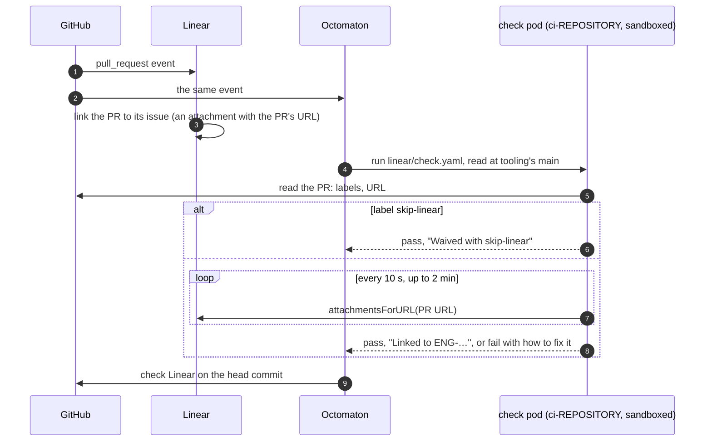

# Check Linear

**Decision**: every pull request in `arikkfir-org` links a Linear issue, or carries the label `skip-linear` when it has none ([CONTRIBUTING.md, "Linear"](../../CONTRIBUTING.md#linear)). Check `Linear`, this repository's organization pipeline `linear`, enforces it: it asks Linear's API whether an issue is attached to the pull request, and every repository's default branch requires it. Linear: [ENG-128](https://linear.app/arikkfir/issue/ENG-128).

## Context

- Nothing required a pull request to link an issue, and the magic word had no rule: of fin's first 120 merges, 90 said `Part of` and 13 `Closes`, ten issues got a single fin pull request that still said `Part of`, and those issues stayed open after their work merged. The Claude Code hook `claude/hooks/pull_request.py` reminded every session to write "`Closes ENG-<n>` or `Part of ENG-<n>`" and nothing on which.
- Linear's GitHub integration already links a pull request to an issue through its branch name, a magic word in its description, or by hand in Linear, and records the link as an attachment on the issue carrying the pull request's URL. `Contributes to` is one of Linear's own non-closing words, beside `Part of` and `Refs`.

## Design

| Event | Why it runs the check |
| --- | --- |
| `opened`, `reopened` | A new pull request |
| `edited` | The description changed; title and base changes run it too, harmlessly |
| `labeled`, `unlabeled` | The waiver came or went |
| `synchronize` | A check belongs to a commit: each new head commit needs its own `Linear` |
| `merge_group` | The merge queue requires the check too. A merge group passes without asking anything ("Checked on the pull request"): its pull requests passed the check to enter the queue |
| Re-run, on GitHub | Linking from Linear's side sends GitHub no event |

Octomaton runs `edited`, `labeled` and `unlabeled` at the same commit as runs of their own, and lets an organization pipeline mount a Secret on pull requests: [Octomaton's part](../../octomaton/designs/linear-check.md).

| Result | Title | Summary |
| --- | --- | --- |
| The pull request carries `skip-linear` | Waived with skip-linear | It needs no Linear issue |
| Linear attaches it to issues | Linked to ENG-… | The issues, linked |
| Neither, after 2 minutes | No Linear issue linked | Add `Closes ENG-123` (or `Part of` while more pull requests are to come), or the label; linked from Linear? Re-run |
| Linear keeps failing for 2 minutes | Linear did not answer | Re-run |
| Anything else (a refused key, GitHub's read failing three times) | Could not check | What failed; re-run |

The results reach the check through task results `check-title` and `check-summary`, which Octomaton recovers from a failed task too.

### What each repository holds

| Repository | Part |
| --- | --- |
| `tooling` | Organization pipeline `linear` in `.octomaton.yaml`; `linear/check.yaml`, the PipelineRun; `linear/check.py`, the check; the Claude Code hook's reminder |
| `octomaton` | [Its part](../../octomaton/designs/linear-check.md): organization pipelines may mount Secrets on any trigger; pull request edits and labels run pipelines again |
| `infra` | Secret Manager's `linear-api-key` ([root gcp](../../infra/terraform/gcp.md#secret-manager)); the label `skip-linear` on every repository and the required check ([root github](../../infra/terraform/github.md)) |
| `delivery` | ExternalSecret `linear-api-key` in every CI tenant ([CI tenants](../../delivery/platform.md#ci-tenants)) |
| `fin`, `octomaton` | `.github/dependabot.yml`: Dependabot's pull requests (security updates; version updates stay off) carry `skip-linear` |
| `docs` | The rules, in [CONTRIBUTING.md](../../CONTRIBUTING.md#linear) |

## Decisions

| Decision | Why | Rejected |
| --- | --- | --- |
| Ask Linear for the link: `attachmentsForURL` with the pull request's URL | It is the link as Linear recorded it, however it was made | Parsing keys from the branch and the description, which repeats Linear's rules and can pass a key Linear never linked; Linear's linkback comment on GitHub, which is optional and stays after an unlink |
| An organization pipeline here | Every repository runs it and none can replace it; its definition comes from `main` | A pipeline in each repository |
| Its key as an Octomaton `secrets` entry | Only pipelines read at a default branch can mount it, so no pull request's own pipeline reaches it | A ServiceAccount that reads Secret Manager at run time, which any pull request's pipeline in that namespace could name |
| Ask again for 2 minutes | GitHub tells Linear and Octomaton at the same time, and Linear links a few seconds later | Linear's webhooks, which Octomaton can't take; failing at once |
| Merge groups pass without asking | Their pull requests passed the check to enter the queue, and a Linear outage can't stall the queue | Checking the entry's pull request again |
| Dependabot's pull requests labelled by its configuration | Security updates have no issue, and the label is the hub's one waiver | Waiving `dependabot[bot]`'s pull requests in the check |
| A personal API key, permission Read on team ENG | One header and nothing to refresh | A Linear OAuth app, whose access tokens expire |
| Agents add `skip-linear` only when their person says so | The label is the one way an agent could turn the check green on its own | No rule for agents |

## Security

- The key reads Linear and nothing else: permission Read, team ENG only. It lives in Secret Manager as `linear-api-key`, and External Secrets Operator copies it into every `ci-*` namespace; Octomaton lets only pipelines read at a default branch mount it, and redacts it from what a run reports.
- The check runs automatically on every pull request, Dependabot's included, so it never fetches or runs the pull request's code: it reads the pull request from GitHub and its link from Linear. Its params reach `check.py` as environment variables, never spliced into a script.
- Its pod is sandboxed like the reviewer's (`kfirs.com/sandbox: "true"`): the internet only, public DNS, no ServiceAccount token, as Tekton's default ServiceAccount, which holds no role.
- Anyone with triage access can add `skip-linear`. The check's title then says "Waived", so the waiver shows on the pull request.

## Failure modes

| Situation | What happens |
| --- | --- |
| Linear links a few seconds after the event | The check asks again every 10 seconds, for up to 2 minutes |
| The pull request is linked from Linear's side | GitHub gets no event: re-run the check |
| Linear is down, or the key was revoked | The check fails saying so; re-run it later, or waive with `skip-linear`. Admins keep their bypass |
| A pull request opened before the check existed | No `Linear` on its head commit: edit its description or push to get one |

## Rollout

1. `octomaton`: organization pipelines' Secrets and pull request changes. Until it runs, Octomaton refuses pipeline `linear`, and a refused organization pipeline stops every pipeline of every repository.
2. By hand: the Linear key (Read, team ENG); the Pull requests permission on `infra`'s two GitHub tokens, which labels need.
3. `infra`: secret container `linear-api-key` and label `skip-linear`; then, by hand, `gcloud secrets versions add linear-api-key --data-file=-`.
4. `delivery`: the ExternalSecret in every tenant.
5. `tooling`: this pipeline, the hook's reminder and this page. Every pull request shows `Linear` from here; nothing requires it yet.
6. `fin`: its Dependabot configuration.
7. `infra`: require `Linear` from the Octomaton App.
8. `docs`: the rules in CONTRIBUTING.md.
