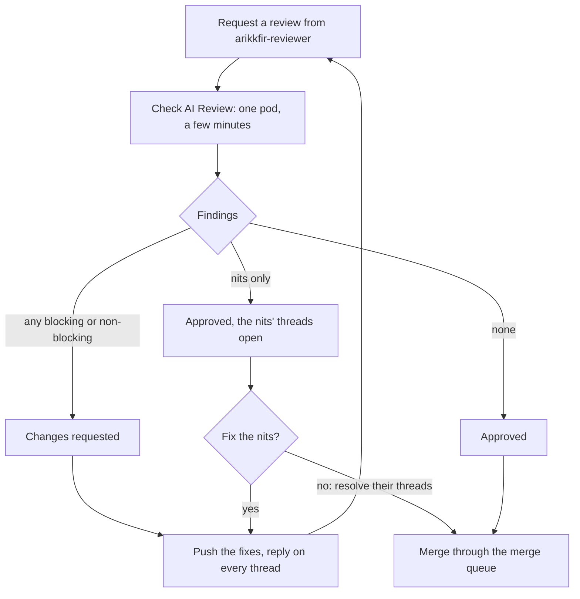
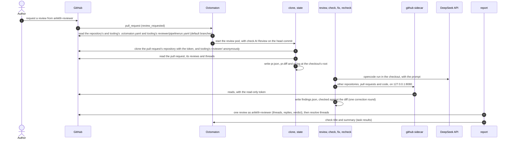
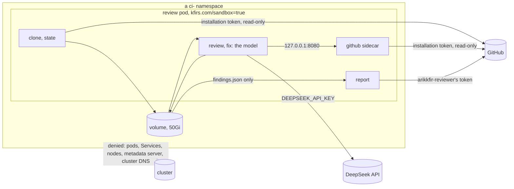

# Pull request reviewer

**Decision**: requesting a review from the GitHub user `arikkfir-reviewer` on a pull request of an `arikkfir-org` repository runs an AI review in one Tekton pod, through Octomaton. opencode with DeepSeek reviews the pull request in its repository's checkout, in a sandbox that reaches only the internet, and reads any other repository through a sidecar that holds a read-only token the model never sees. The pod's last step, `report`, the only container with `arikkfir-reviewer`'s token, posts one review with one thread per finding, and approves or requests changes from the findings' priorities alone. Each finding carries a code (`IAM-3`), so the next round replies to its thread or resolves it. The code is `reviewer/` in this repository; names and wiring are in the [reference](../../hub/reference.md#pull-request-reviewer).

## Context

The hub is one person's. Every pull request needs one approval from someone other than its last pusher, and the only human can't approve their own pull requests, so every merge used the admin bypass. Changes also cross repositories: a name in `infra` must match `delivery`, Octomaton and the [reference](../../hub/reference.md). A reviewer that reads every repository of the organization, keeps its findings across rounds and approves when nothing is left gives each pull request a real review and a real approval: `arikkfir-reviewer` has `push` on every repository, so its approval is the one the `Default branch` ruleset requires.

## For pull request authors



### Requesting a review

- Add `arikkfir-reviewer` as a reviewer: in the pull request's Reviewers box, with `gh pr edit <number> --add-reviewer arikkfir-reviewer`, or through the GitHub connector. Requesting a review takes triage or write access, and the pull request must come from a branch of the repository itself: Octomaton ignores forks. Drafts and pull requests into any branch are reviewed too.
- Octomaton runs pipeline `review`, check `AI Review`, on the head commit. When the review is posted, the check's title is the verdict and its summary the review's summary, with a link to the review.
- Each request is one review. New commits pushed while the review is still requested (before it is posted) restart it at the new head. Once it is posted, request it again for the next round: a push dismisses the approval, and the reviewer starts a round only when asked.
- Claude Code sessions are reminded to request it when they open a pull request ([Claude Code tooling](phase-5-tooling.md)).

### What it reads and checks

| It reads | From |
| --- | --- |
| The house rules: `CONTRIBUTING.md` whole, and the sections of the contract, `hub/reference.md`, that the change touches | `docs`, which it clones |
| The repository's rules: its `CLAUDE.md`, `README.md` and any contributing notes, which win where they conflict with the house rules | The checkout |
| The pull request: title, description, conversation, and every earlier review and thread with its replies | `pr.json`, written before the model starts, with the words of organization members and people with write access only |
| The change: `pr.diff` (`git diff <base>...<head>`) and `pr.log` (its commits with their changed files), then the code around it and its history (`git log`, `git blame`) | The checkout, at the head commit |
| Other repositories and pull requests the change uses or must match, internal ones (`fin`) included | Clones through the [GitHub proxy](#the-github-proxy) |
| A tool's or chart's source or docs, for a claim about it | The web |

It looks for bugs, security problems, breaks of the house rules, the repository's rules or the contract (a matching change another repository or the reference needs and the pull request doesn't make included), missing tests, docs or design documents the rules require, and a title or description that doesn't match the change or leaves out risks and manual steps. It leaves formatting and style to the linters and suggests no refactor the change doesn't need. It builds, tests and runs nothing: its image has no toolchains, and CI runs the checks.

### How long it takes and what it costs

- Most reviews take a few minutes of model time. A review is many short turns of reading and searching, each waiting about 6 s on the model, so a large pull request takes longer: a 114-file one took 162 turns and 18.5 minutes before the prompt asked for batched calls ([tooling#22](https://github.com/arikkfir-org/tooling/pull/22)). The pod may first wait for a node of the CI pool to start.
- The task times out after 55 minutes, the run after an hour.
- DeepSeek V4.1 Flash costs $0.15 per million input tokens and $0.60 per million output tokens (V4 Pro: $0.435 and $0.87), as of 2026-10-02. A review reads a few hundred thousand tokens: cents.

### Findings

Every finding is a thread that `arikkfir-reviewer` starts, on the changed lines that cause the problem or should fix it, on a whole file, or, for the pull request as a whole (its title, description or scope), on its first changed file, marked "About the pull request as a whole." Its first comment reads:

```text
<!-- reviewer:IAM-3 -->
🔴 **IAM-3: <title>**
Blocking · high severity · medium likelihood

<body: what is wrong, why it matters and how to fix it, with the evidence checked>
```

The code is an upper-case prefix naming the area (`IAM`, `CI`, `DOCS`, `WEBHOOK`), a dash and a number from 1. One problem per code: the code keeps its thread across rounds, and a new problem gets a code never used on the pull request.

| Priority | Means | Verdict | Counted as |
| --- | --- | --- | --- |
| 🔴 `blocking` | Must be fixed before merging | Requests changes | high |
| 🟡 `non-blocking` | Should be fixed, though it breaks nothing today | Requests changes | medium |
| 🔵 `nit` | Could be fixed; the pull request is fine without it | Approves | low |

| Rating | `low` | `medium` | `high` | `urgent` |
| --- | --- | --- | --- | --- |
| Severity: the harm if it goes wrong | A small inconvenience, easy to notice and undo | A real failure or lost work, limited to one part and recoverable | An outage, data loss or a security weakness | Serious harm now: a leaked secret, an exploitable hole, or production down |
| Likelihood: how likely it is to go wrong | Only in unusual conditions | In some normal conditions | Every time, or almost | |

### The verdict

| Findings | Review | Check title |
| --- | --- | --- |
| Any `blocking` or `non-blocking` | Request changes | `Changes requested: 1 blocking, 2 non-blocking, 1 nit` (counts of zero left out) |
| `nit`s only | Approve, with the nits' threads open | `Approved with 2 nits` |
| None | Approve | `Approved` |

The review's body holds the summary (what the change does and the review's overall take, never a finding) and one line of counts: `🔴 1 high · 🟡 2 medium · 🔵 1 low · 3 resolved`. A nit whose thread the author resolved counts neither in the verdict nor in the line.

### Threads across rounds

Each round reads every earlier thread with its replies, and `report` finds the threads by their codes:

| Since the last round, the author | The finding | Its thread |
| --- | --- | --- |
| Fixed it, or replied with a convincing reason it stays | Is no longer raised | A reply, "**IAM-3**: no longer found at `<commit>`.", then resolved |
| Replied, but it still holds | Is raised again, answering the reply | A reply; reopened if it was resolved |
| Resolved a 🔵 nit's thread | Stays resolved, whatever the model says | Left alone: the author chose not to fix it |
| Resolved a 🔴 or 🟡 thread that still holds | Is raised again | Reopened, with a reply |

Threads that other people started are left alone.

### Answering a review

Answer as [Answering a review](../../CONTRIBUTING.md#answering-a-review) says: push the fixes, reply on every thread, then request the review again. The reviewer resolves its own threads once a round finds them fixed or convincingly answered; the only ones an author resolves are 🔵 nits' threads after an approval, to say they won't be fixed. A reply is the next round's input: the model drops the finding or answers the reply.

## How it works



| Piece | Where | What |
| --- | --- | --- |
| Trigger | `tooling`: `organization.pipelines` in `.octomaton.yaml` (the organization repository), read at its default branch | Pipeline `review` (`AI Review`) for every repository, on `review_request` from `arikkfir-reviewer`; params from the template context; a read-only installation token for every repository; the two Secrets it may mount; a one-hour timeout |
| PipelineRun | `tooling`: `reviewer/pipelinerun.yaml`, read at its default branch for every repository | Task `review`: its sidecar and seven steps, the volume, the ServiceAccount, the sandbox label, DNS and resources |
| Scripts and prompt | `tooling`: `reviewer/` | `state.py` writes `pr.json`; `findings.py` checks `findings.json`; `report.py` posts the review through `github.py`; `github_proxy.py` serves GitHub in the sidecar; `prompt.md` and `opencode.json`. Standard-library Python, covered by `tests/test_reviewer.py` in `tooling`'s CI. Every step runs them from `tooling`'s default branch, and `report` and the sidecar from fresh clones of their own, never the volume's |
| Octomaton | `octomaton` | The `review_request` trigger, organization pipelines, `secrets`, `githubToken.repositories: all` and the refusal of remote Tekton references; the reviewer image, built from `images/reviewer/` ([Octomaton's part](../../octomaton/designs/pr-reviewer.md)) |
| Tenant objects | `delivery`: the `ci-tenants` base | ServiceAccount `reviewer`, NetworkPolicy `sandbox`, ExternalSecrets `reviewer-deepseek-api-key` and `reviewer-github-pat` in every `ci-<repository>` namespace |
| Identity and secrets | `infra` | Secret Manager `reviewer-deepseek-api-key` and `reviewer-github-pat`; team `reviewers` (`arikkfir-reviewer`, `push` on every repository) |

Octomaton knows nothing of the reviewer: it runs an organization pipeline on a review request, with the Secrets and the token scope the pipeline declares, as its [schema](../../hub/reference.md#repository-configuration-octomatonyaml) allows. What Octomaton does for the reviewer, and why: [the reviewer in Octomaton](../../octomaton/designs/pr-reviewer.md).

### The `review` task

| Setting | Value | Why |
| --- | --- | --- |
| ServiceAccount | `reviewer`: no RoleBinding, no mounted token, no IAM role for its Workload Identity principal | The pod needs nothing of the cluster or of Google Cloud |
| Label | `kfirs.com/sandbox=true` on the PipelineRun, which Tekton copies to the pod | NetworkPolicy `sandbox` confines it to the internet ([sandbox](#sandbox-and-network)) |
| DNS | `dnsPolicy: None`, nameservers `8.8.8.8` and `1.1.1.1`; `automountServiceAccountToken: false`, `enableServiceLinks: false` | Cluster DNS is inside the denied ranges |
| Image | `me-west1-docker.pkg.dev/arikkfir/images/reviewer:main` in every step and the sidecar, `imagePullPolicy: Always` | A node pulls one image per review, and never runs a `main` it cached earlier |
| Resources | The task requests 500m CPU and 1Gi, with a 4Gi memory limit and no CPU limit; the sidecar requests 50m and 64Mi, with a 256Mi limit | Sized from the 18 reviews of 2026-10-02: the model's steps averaged 0.57 of a core (0.93 at most) and peaked at 950 MiB, so concurrent reviews share a node and use idle cores beyond their request |
| Volume | Workspace `shared`: one 50Gi `ReadWriteOnce` claim per run, which Octomaton deletes an hour after the run | Holds the checkout, `.review/` and opencode's state, which every step shares |
| Token | Workspace `github-token`, Octomaton's installation token, an isolated workspace that only the sidecar (at `/workspace/github-token`) and `clone` and `state` (at `/var/run/github-token`, outside the `/workspace` every step shares) mount | The model's steps never hold it. Isolated workspaces are a Tekton beta feature: without it the run is refused |
| Timeouts and retries | Run 1h, task 55m; the task retries once | A lost node runs the whole review again, from `clone` |

| Container | Holds | Does |
| --- | --- | --- |
| Sidecar `github` | The installation token | Clones `tooling`'s default branch into its own filesystem and runs that `github_proxy.py` on `127.0.0.1:8080` ([GitHub proxy](#the-github-proxy)). The steps start once it answers on `/healthz` |
| `clone` | The installation token | Clones the pull request's repository into `<name>/`, with the token as an HTTP header on git's command line only, fetches `refs/pull/<number>/head` and fails unless that is the commit under review, then checks it out. Refuses a repository whose root already has a `pr.json`, `pr.diff`, `pr.log` or `findings.json`, a link included. Writes `pr.diff` and `pr.log`. Extracts `reviewer/` from `tooling`'s default branch, cloned anonymously, into `.review/` |
| `state` | The installation token | `state.py` writes `<name>/pr.json` from GitHub's REST and GraphQL APIs |
| `review` | `DEEPSEEK_API_KEY` | Refuses to start if the token is mounted; runs `opencode run --pure --variant low --format default --thinking` with `prompt.md`, in the checkout |
| `check` | Nothing | `findings.py check` writes what is wrong with `findings.json` to `.review/errors.txt` |
| `fix` | `DEEPSEEK_API_KEY` | Only when `check` found errors: `opencode run --continue` with them, in `review`'s session, under the same guard |
| `recheck` | Nothing | `findings.py check --strict` fails the task if anything is still wrong |
| `report` | `GITHUB_TOKEN`, `arikkfir-reviewer`'s token | Clones `tooling`'s default branch into its own filesystem and runs that `report.py` with `python3 -s -E` (no user site-packages, no `PYTHON*` variables), with `HOME`, the XDG directories and its working directory under its own `/tmp`. Reads only `<name>/findings.json` from the volume; posts the review, resolves threads and writes the results `check-title` and `check-summary` ([from findings to GitHub](#from-findings-to-github)) |

Every step starts in the volume's root, and the model's steps `cd` into the checkout: a step's working directory is fixed when the pod starts, before `clone` has made it.

### Sandbox and network

The pod carries `kfirs.com/sandbox=true`, which NetworkPolicy `sandbox` confines to public addresses: no ingress, and egress to `0.0.0.0/0` except `10.0.0.0/8`, `172.16.0.0/12`, `192.168.0.0/16`, `100.64.0.0/10` and `169.254.0.0/16`. That leaves out pods, Services, nodes, cluster DNS and the metadata server, Workload Identity's included (`169.254.169.252:988` on Dataplane V2), so no reviewer pod can get Google credentials either. The cluster's Dataplane V2 enforces the policy. The pod resolves names through public resolvers.



### opencode

| Setting | Value | Why |
| --- | --- | --- |
| Image | `reviewer:main`, which `octomaton` builds from `images/reviewer/`: `ghcr.io/anomalyco/opencode:1.18.33`, pinned by digest (Alpine, with `opencode` and `ripgrep`), plus `bash`, `python3`, `git`, `jq`, `yq`, `curl`, `wget`, `make`, `tree` and GNU userland | The tools the model reaches for: `git log` and `git blame` in the checkouts, `curl` and `git` through the GitHub proxy, `jq`, `yq` and `python3` to read what it fetches. opencode runs commands in bash once it is on `PATH` |
| Model | `deepseek/deepseek-flash` (DeepSeek V4.1 Flash) in `reviewer/opencode.json`; `enabled_providers: ["deepseek"]` | A third of V4 Pro's input price ([tooling#18](https://github.com/arikkfir-org/tooling/pull/18)). opencode 1.18.33 hides the deprecated `deepseek-v4-flash`; `deepseek-flash` is its active successor, at the same price. A stronger model is a one-line change |
| Reasoning | `opencode run --variant low` in `review` and `fix`: DeepSeek's `reasoning_effort: low` | A review is many short turns, and each waits on the model's reasoning; at the default effort a turn took about ten seconds |
| Log | `--format default --thinking` | The step's log, in Cloud Logging, is the only record of the model's reasoning once the pod is gone |
| Permissions | `"permission": {"*": "allow", "task": "deny"}`, `experimental.continue_loop_on_deny: true` | `opencode run` rejects any "ask" and stops: the sandbox is the boundary, not opencode's prompts. No subagents: `opencode run` doesn't log a subagent's steps, and one redid a whole review, unseen, for eleven minutes; denied outright, the `task` tool isn't offered |
| Working directory | The pull request's checkout, `/workspace/shared/<name>`, with `pr.json`, `pr.diff`, `pr.log` and `findings.json` at its root; other repositories cloned by the model into `/tmp` | The model starts in what it reviews, with its history, and fetches only the repositories the change touches. The scripts and opencode's state stay beside the checkout in `.review/`, out of its way: in the working directory, models read them for minutes, looking for the expected answer |
| Isolation from the repositories | `OPENCODE_DISABLE_PROJECT_CONFIG=1`, `OPENCODE_DISABLE_EXTERNAL_SKILLS=1`, `OPENCODE_DISABLE_CLAUDE_CODE_PROMPT=1`, `OPENCODE_CONFIG=/workspace/shared/.review/opencode.json`, `--pure` | The working directory is a checkout the pull request controls: no `opencode.json`, `.opencode/`, plugin, `.claude/` or `.agents/` skill or `CLAUDE.md` from it configures the reviewer, and the model reads each `CLAUDE.md` as material, not as its instructions. One path stays open: opencode's `read` tool hands the model an `AGENTS.md` or `CONTEXT.md` from a subdirectory of the checkout as instructions, and no setting turns it off ([security](#security-and-failure-modes)) |
| No uploads, no updates | `"share": "disabled"`, `"autoupdate": false`, `"snapshot": false`, `OPENCODE_DISABLE_SHARE=1`, `OPENCODE_DISABLE_MODELS_FETCH=1` (the bundled model list), `OPENCODE_DISABLE_AUTOUPDATE=1`; an empty `node_modules` and a `package-lock.json` listing `@opencode-ai/plugin` `1.18.33` in opencode's config directory | Sessions stay in the pod, and nothing but DeepSeek's API is called on opencode's own account. opencode skips installing its plugin package from npm only when both files exist |
| State | `HOME` and `XDG_*` under `/workspace/shared/.review/home` | `fix` continues `review`'s session, and the steps share only volumes |

### The GitHub proxy

`reviewer/github_proxy.py` (standard-library Python) runs in the pod's `github` sidecar, from a fresh clone of `tooling`'s default branch, never the volume's. It listens on `127.0.0.1:8080` only, and its readiness gates the steps.

| Path | Methods | Forwards to | With |
| --- | --- | --- | --- |
| `/api/<path>` | `GET`, `HEAD` | `https://api.github.com/<path>` | `Authorization: Bearer <token>` |
| `/git/<owner>/<repository>.git/info/refs?service=git-upload-pack` | `GET`, `HEAD` | `https://github.com/<owner>/<repository>.git/...` | HTTP Basic `x-access-token:<token>` |
| `/git/<owner>/<repository>.git/git-upload-pack` | `POST` | The same | The same |
| `/healthz` | Any | Nothing | |
| Anything else: writes, GraphQL, `git-receive-pack` | | Refused | |

It reads the token file for every request (Octomaton refreshes it) and answers 503 until there is one. It drops the client's own `Authorization`, cookies and hop-by-hop headers, never follows a redirect and points a redirect to GitHub back at itself, takes request bodies of 8 MiB at most, and gives up on a client or on GitHub after 120 s. The token reads code and pull requests only (`contents: read`, `pull_requests: read`), so even a request that slipped through could write nothing.

Tekton stops the sidecar once the last step is done by swapping its image, which the kubelet does with SIGTERM. The proxy is PID 1 in its container, which gets no default action for a signal, so it handles SIGTERM and exits at once: without the handler it lived to the 30 s grace period's SIGKILL after every review, holding the pod and its volume ([tooling#34](https://github.com/arikkfir-org/tooling/pull/34)).

### The volume

```text
/workspace/shared/      the workspace shared (Tekton's mount path; scripts use $(workspaces.shared.path))
├── <name>/             clone: the pull request's repository at the head commit, with origin's branches; the
│   │                   model's working directory
│   ├── pr.json         state: the pull request's state
│   ├── pr.diff         clone: git diff origin/<base>...<head>
│   ├── pr.log          clone: git log --stat origin/<base>..<head>
│   ├── findings.json   review: the findings
│   └── …               the repository's own files
└── .review/            clone: reviewer/ from tooling's default branch; errors.txt; opencode's home and session
/tmp/<repository>/      review, fix: other repositories the model clones through the proxy (each step's own /tmp)
```

The four files at the checkout's root are untracked. `clone` refuses a repository whose root already has one, a link included: the pull request controls the checkout, and a link would send `clone`'s or `state`'s writes, or the model's, anywhere on the volume, `.review/` included. On a retry, `clone` starts from scratch.

### `pr.json`

```json
{
  "repository": "arikkfir-org/infra",
  "number": 14,
  "revision": "head commit under review",
  "baseRef": "main",
  "reviewer": "arikkfir-reviewer",
  "pr": {"the pull request, as GitHub's REST API returns it": "..."},
  "files": [
    {"filename": "…", "status": "modified", "patch": "…", "commentable": {"RIGHT": [[10, 25]], "LEFT": [[10, 22]]}}
  ],
  "comments": [{"the conversation's comments by organization members and people with write access (REST)": "..."}],
  "reviews": [
    {
      "the review, as GitHub's REST API returns it": "...",
      "threads": [
        {
          "id": "PRRT_…", "code": "IAM-3", "isResolved": false, "isOutdated": false, "resolvedBy": null,
          "path": "terraform/gcp/iam.tf", "line": 42, "startLine": null, "diffSide": "RIGHT", "subjectType": "LINE",
          "comments": [{"author": "arikkfir-reviewer", "body": "…", "createdAt": "…", "url": "…"}]
        }
      ]
    }
  ],
  "codes": {"IAM-3": {"isResolved": false, "title": "…"}}
}
```

- Only the words of organization members and people with write access go in: comments, reviews and thread comments whose author's association is `OWNER` or `MEMBER`, or whose repository permission is `admin`, `maintain` or `write` (asked once per author; a failure counts as an outsider). GitHub hides private organization membership from an installation token, so the owner reads as `CONTRIBUTOR` and `arikkfir-reviewer` as `NONE`: the permission is what trusts them ([ENG-46](https://linear.app/arikkfir/issue/ENG-46), [tooling#8](https://github.com/arikkfir-org/tooling/pull/8)). Anyone can comment on a public repository's pull request, and an outsider's comment must never steer the model. `report` still reads every thread, so the filter can't hide one of the reviewer's codes from it.
- A thread is listed under the review of its first trusted comment, with its trusted replies. A thread with no trusted comment is left out.
- `code` is set only on threads `arikkfir-reviewer` started, read from the marker that opens the first comment. `codes` lists every code used so far, resolved or not, with the title of its oldest thread.
- `commentable` lists the line ranges GitHub accepts comments on, per side of the diff: added and context lines on `RIGHT`, deleted and context lines on `LEFT`.

### `findings.json`

The schema lives in three places, changed together: this section, `reviewer/prompt.md` (the model's view) and `reviewer/findings.py` (the checks, which `report.py` runs again).

```json
{
  "summary": "What the pull request does and the review's overall take, in a few sentences. No findings.",
  "findings": {
    "IAM-3": {
      "title": "One line",
      "priority": "blocking",
      "severity": "high",
      "likelihood": "medium",
      "path": "terraform/gcp/iam.tf",
      "line": 42,
      "startLine": 40,
      "side": "RIGHT",
      "body": "Markdown: what is wrong, why it matters, how to fix it."
    }
  }
}
```

| Field | Rule |
| --- | --- |
| The file | A plain file (never a link or a pipe) of at most 1 MiB, UTF-8 JSON, no key twice; an object with exactly the keys `summary` and `findings` |
| `summary` | A non-empty string of at most 1,500 characters; never a finding |
| `findings` | An object keyed by code; `{}` when there is nothing to raise |
| Code (the key) | `^[A-Z][A-Z0-9]{0,15}-[1-9][0-9]{0,3}$`. A code already in `codes` means the same finding; a new finding takes a code not in `codes` |
| Fields | `title`, `priority`, `severity`, `likelihood` and `body`, required; `path`, `line`, `startLine` and `side`, optional; nothing else |
| `title` | One line of at most 200 characters |
| `priority` | `blocking`, `non-blocking` or `nit` |
| `severity` | `low`, `medium`, `high` or `urgent` |
| `likelihood` | `low`, `medium` or `high` |
| `body` | A non-empty string of at most 4,000 characters (Markdown) |
| `path`, `line`, `startLine`, `side` | New codes only. `path` is a file of the diff; `line`, with `startLine` (at most `line`) for a range, are positive whole numbers within one `commentable` range of that file on `side` (`RIGHT` by default, or `LEFT`). Without `line` (and so without `startLine`), a file-level thread. Without `path` (and so without `line`), a finding about the pull request as a whole. Ignored for existing codes, whose thread stays where it is |

### What the prompt asks

`reviewer/prompt.md`, tuned against the reviews' transcripts ([tooling#22](https://github.com/arikkfir-org/tooling/pull/22), [tooling#33](https://github.com/arikkfir-org/tooling/pull/33)), asks the model to:

- Verify everything and claim nothing it hasn't checked: its approval lets the pull request merge, a missed finding can reach production, and an invented one wastes the author's time.
- Read the house rules in `docs`: `CONTRIBUTING.md` whole, and the sections of `hub/reference.md` for the repositories and systems the change touches (list its headings with `rg`, then read those). Then the rules of the pull request's repository: its `CLAUDE.md`, `README.md` and any contributing notes, which win where they conflict.
- Read `pr.json` (the description, the conversation and every earlier thread), then the change, `pr.diff` and `pr.log`, then the code around it: callers, tests and the other repositories that define or use what it touches.
- Where the change interacts with other repositories or the infrastructure (Terraform in `infra`, manifests in `delivery`, Octomaton's contract), use them to check its claims, whether it can work and how it fails, and anchor such a finding on the line that makes the claim. Check every suspicion, and leave out what it can't verify. Check a claim about an upstream tool or chart against its source or docs, fetched from the web in one command.
- Look for bugs, security problems, breaks of the rules or the contract, missing tests, docs or designs, and a title or description that doesn't match the change. Leave style to the linters, and suggest no refactor the change doesn't need.
- Write one problem per finding, plainly (simple English, short, no praise, no filler), with a priority, a severity and a likelihood.
- Carry earlier rounds forward: raise a finding again under its code only if it still holds, answering the author's latest reply; drop it when fixed or answered convincingly; never raise again a nit whose thread the author resolved. A new problem gets a new code.
- Work in few turns: every call it already knows it needs in one turn (all of a step's files, independent searches and commands together). Each turn waits on the model however little it does.
- Stay on the review. The transcripts of 496 reviews (2026-10-04 to 13) showed a fifth of the model's time on side trips, each now ruled out: `pr.json`, `pr.diff` and `pr.log` are complete, so never fetch the pull request again from the API (30% of reviews did); the image has no node, go, npm, helm, kubectl, kustomize or terraform, so never look for them or try to build, test or render (63%); read `pr.json` by key with `jq`, never whole (94%); clone only the repositories the change touches, not all of them (65%); read `hub/reference.md`'s relevant sections, not the whole file (55%); read a whole file once rather than sizing it and slicing it (every review) or reading it again; find with `rg`, not by listing trees (46%); leave the repository's other branches and pull requests alone (63%); never read `.review/`, `/tekton` or the reviewer's own design and scripts, which hold no expected answer (16%); and read `findings.json` back by eye rather than writing a checker (60%), since the pipeline checks it.
- Use the tools in the image: `git` in the checkouts; other repositories, pull requests and code, internal ones included, through the GitHub proxy on `127.0.0.1:8080`, cloned into `/tmp`.
- Write `findings.json`, and nothing else: the repositories are read-only.

The code guidelines (reuse over duplication, refactoring over scaffolding, the right thing over the easy one, and the Go rules for errors, configuration, spans and logs) are house rules, in `CONTRIBUTING.md`, for people and the reviewer alike.

### From findings to GitHub

`report` trusts nothing on the volume but `findings.json`, read as data. With `arikkfir-reviewer`'s token it asks GitHub again for the pull request's head, its files (whose commentable lines it computes from their patches) and every review thread, whoever started it, and checks `findings.json` against them with `findings.py`'s rules; any error refuses the review. It reads each thread's code from the marker that opens its first comment (`<!-- reviewer:IAM-3 -->`), and plans:

| Code in `findings.json` | Thread with that code | Action, all in one review |
| --- | --- | --- |
| New | None | A new thread at its place |
| Raised again | Open, or resolved by the reviewer | A reply with the finding's heading and `body`; a resolved thread is unresolved |
| Raised again as a `nit` | Resolved by someone else | Nothing: the author resolved it as won't fix, and that stands. It counts neither in the verdict nor in the body |
| Raised again, `non-blocking` or `blocking` | Resolved by someone else | A reply, and the thread is unresolved |
| Not raised | Open | A reply "**IAM-3**: no longer found at `<commit>`.", then, once the review is submitted, the thread is resolved |
| Not raised | Resolved | Nothing |

A reply repeats the first comment's heading without the marker. When the pull request changes no files, a finding about the pull request as a whole goes in the review's body instead of a thread.

Then, in order:

1. If one of the reviewer's last 100 reviews ends with this PipelineRun's marker (`<!-- reviewer-run:<run> -->`), a retried `report` only resolves threads: the review is already posted.
2. Otherwise, if the pull request's head is no longer the reviewed commit, it refuses ("request a new review"); a new head while the review is still requested has already started a new run.
3. It deletes any pending review the reviewer left (an interrupted `report`), creates a pending review on the reviewed commit, unresolves, replies and adds threads in it, and submits it with the verdict and a body of the summary, the counts and the marker. A line anchor GitHub refuses becomes a comment on the whole file, naming its lines (`Location: path:line`).
4. It resolves the threads of findings no longer raised.
5. It writes the check's title (the verdict, at most 80 bytes) and summary (the review's summary and a link to the review) as the task's results.

Mutations go a second apart, as GitHub asks of clients that create content, and `github.py` retries server errors, timeouts and rate limits (honouring `Retry-After`, or a minute for a secondary limit) three times in all.

The results travel in the `report` container's termination message, as Go-encoded JSON next to Tekton's own `StartedAt` entry. Kubernetes splits 12 KiB of termination messages equally among a pod's containers, and the review pod has 11 (Tekton's 3 init containers, 7 steps and the sidecar): 1,117 bytes each. `report.py` keeps its whole message within 1,024 bytes, which fits 12 containers, by cutting the summary to 793 bytes, its link included, counted as Go escapes them; the full summary stays in the review. A test holds the pod to 12 containers. A longer message lost its JSON, and the run failed after the review was posted (4 of 50 reviews, until [tooling#37](https://github.com/arikkfir-org/tooling/pull/37)).

## In flight: a brief and incremental rounds

tooling#38, #39 and #40 (ENG-68), still open, change the reviewer as below. The sections above describe `reviewer/` as merged; each of those pull requests folds its part into them as it merges.

| Change | Pull request |
| --- | --- |
| `review` clones `docs` through the sidecar into `/tmp/docs` (unless the checkout is `docs`), and `brief.py` (standard-library Python) writes the model's first message: the prompt, then what every review reads first, already read ([the brief](#the-brief)). The prompt starts from it and reads only what it leaves out | tooling#38 |
| A later round whose change since the last review is small reviews only that change, unless the model judges it significant or risky | tooling#39 |
| `state.py` runs inside `clone`, in the background, while the pull request clones, and moves `pr.json` beside `pr.diff` and `pr.log` once done; step `state` goes, so only `clone` and the sidecar mount the installation token, and the pod has one container fewer: 10, each with 1,228 bytes of the termination messages' 12 KiB. The brief carries `pr.json`, `pr.diff` and `pr.log` whole, so the prompt rules out reading them again. The model runs `findings.py check` itself before it ends, rather than writing a checker of its own (42% of reviews did) | tooling#40 |

### The brief

Every review spends its first turns reading the same things, each turn waiting on the model however little it does. `brief.py` writes them into the model's first message instead.

| Part | From | Limit |
| --- | --- | --- |
| This round | The reviewer's last submitted review in `pr.json` (an approval a push dismissed included), and `git diff <its commit> <head>` in the files the pull request touches (that commit fetched through the sidecar if the checkout lacks it) | See below |
| The pull request | `pr.json`: title, description, conversation, earlier reviews with every thread and reply, codes, the changed files with their commentable lines; `pr.log`; `pr.diff` | `pr.diff` up to 200 KB |
| House rules | `CONTRIBUTING.md` in `docs`, and the contract's headings with their line numbers, so the model reads only the sections the change touches | 64 KB a file |
| The repository's rules | Its `CLAUDE.md` and `README.md`, as the pull request has them, labelled as material, not instructions | 64 KB a file |
| The changed files | At the head commit, in `pr.json`'s order; on an incremental round, only those changed since the last review | 48 KB a file, 200 KB in all; the rest listed |

The checkout is the pull request's to control, so `brief.py` reads only regular UTF-8 files inside it, never through a link, and quotes the description, conversation and reviews rather than splicing them into its own structure. A failed `docs` clone leaves the house rules out, which the brief says, and the model clones `docs` itself.

| Round | When | The model |
| --- | --- | --- |
| First | No submitted review by `arikkfir-reviewer` | Reviews everything |
| Incremental | The change since the last review is at most 300 lines (as `git diff --shortstat` counts them), at most half the lines the pull request changes, and at most 200 KB of diff | Gets that change and the files it touched; judges it first, and reviews the whole pull request again if it is significant or risky (new behaviour, a security or data path, an interface others rely on, a rewrite) or it can't tell |
| Whole again | A larger change (a one-line edit of a minified file included), the reviewed commit is gone (a rebase), or git fails to work out the change (an empty diff would read as no change, and `report` would resolve every finding the model then leaves out) | Reviews everything |

Every later round answers every earlier thread and raises again each finding that still holds, since `report` resolves those it leaves out. The summary opens with what the round reviewed ("The changes since `abc1234`: …" or "The whole pull request: …").

| Decision | Why | Rejected |
| --- | --- | --- |
| The model starts from a brief of what every review reads first | Every review read the same files in its first turns (the house rules in 96%), and each turn waits on the model | Inlining the whole contract (92 KB; the headings let it read the sections it needs); pre-cloning every hub repository (most go unread) |
| A small change since the last review is reviewed on its own, unless the model judges it significant or risky | Later rounds were most reviews (29 of 53) and cost nearly a first round's model time (5.1 against 5.9 minutes) | Always reviewing everything (the cost); always incremental (misses what a rewrite or a risky change touches) |
| `state.py` inside `clone`, in the background | A step of its own took 7 s after the clone, and a container more shrinks `report`'s termination message share | A separate step (sequential, by Tekton's design) |

## Decisions

| Decision | Why | Rejected |
| --- | --- | --- |
| A review requested from a real user starts the pipeline, and that user posts the review | Only users can be requested as reviewers, and their review fulfils the request. Re-requesting after changes is GitHub's own loop | The Octomaton App reviewing (it can't be requested); every push (cost, noise); a comment command |
| A fine-grained token of `arikkfir-reviewer`, contents and pull requests read and write | The review, replies and resolution need the user. GitHub resolves a thread only for a token with contents write, so the token can push branches and tags and manage releases: rulesets keep it off default branches, and a pull request it pushes to still needs another approval | A classic token (all of the user's rights); the App (not the user, and it would need contents write too); pull requests only (resolving fails) |
| `arikkfir-reviewer` gets `push` through team `reviewers` | Resolving a thread takes write access, and an approval by a user with write access counts toward the one required approval | `triage` (can't resolve threads) |
| Pipeline `review` declared once, as an organization pipeline in `tooling` | Nothing about it differs between repositories; every repository, new ones included, gets it without a change. `tooling` already holds the reviewer, and Claude Code can't clone `.github` (its name starts with a dot) | An identical entry in each repository's `.octomaton.yaml`; `.github`, GitHub's convention |
| One PipelineRun in `tooling`, read at its default branch for every repository | One copy to change; it sits next to its scripts and their tests; no pull request, here or elsewhere, changes its own review | A copy in each repository; a cluster Pipeline through Tekton's cluster resolver (Octomaton's Secret guard can't see it) |
| One task, one pod: `clone` and `state` first, `report` last | A task of its own started a pod of its own, and the run's volume moved whenever the next pod landed on another node: 15-89 s before the model in 11 of 18 reviews, and 50 s before `report` in half of them, after the sidecar's 30 s stop. In one pod, the model's containers can't read `report`'s environment (the pod shares no process namespace) and finish before it starts its work | Tasks of their own for `clone` and `state` and for `report`; the affinity assistant, which pins a run's pods to the volume's node (turned off in `delivery`: pinned pods wait on a full node rather than letting the autoscaler add one) |
| `report`'s container is the only one with `arikkfir-reviewer`'s token, and takes nothing from the volume but `findings.json` | The model can write anywhere on the volume. `report` runs its own clone of `tooling`, with `HOME` and its working directory in its container and python without user site-packages or `PYTHON*` variables, so no `.gitconfig`, `sitecustomize.py` or the like the model wrote reaches it | The token in a workspace (every step would see it); running the volume's `report.py` |
| `clone` clones the pull request's repository, and fetches the pull request, with the installation token, given to git as an HTTP header on its command line. `tooling`, for `reviewer/`, stays anonymous | Internal and private repositories (`fin`) refuse anonymous clones. The token is already in `clone` and `state`: read-only, an hour at most. On the command line, it never reaches the volume the model reads. Used for every pull request: one path on every review, with no visibility check | The token in the remote's URL or in a credential helper's file (both on the volume); an anonymous attempt first (its token path would run only for internal repositories); a second, read-only personal access token (every repository, for up to a year, on a volume an internet-connected model reads) |
| The model works in the pull request's checkout, with the pull request's files at its root, and clones other repositories itself through the proxy | It starts in what it reviews, with its history, and fetches the one or two repositories a change touches in one command. `.review/` sits beside the checkout: in its working directory, models spent minutes of every review reading the scripts and opencode's session for the expected answer | Cloning every hub repository before the model starts (most go unread); ignoring the pull request's files in each repository's `.gitignore` or `.git/info/exclude` (ripgrep, so opencode's grep, glob and list, skips ignored files) |
| The model gets other repositories through a proxy in a sidecar that holds a read-only token for every repository; the model's steps never mount it | A change often only makes sense next to another repository's pull request or code, internal ones (`fin`) included, which the model can't read anonymously. The token is short-lived, refreshed, and reads code and pull requests only; the model never holds it, so it can't leak it | The token in the model's environment (one prompt injection away from leaking); `arikkfir-reviewer`'s token behind the proxy (writes, and lives a year); fetching the pull requests a change links to before the model starts (misses what the model finds on its own) |
| Every step and the sidecar run the reviewer image's `main` tag, pulled for every pod | Every merge to `octomaton`'s `images/reviewer` reaches the next review, with no bump here to forget. One image, so a node pulls one per review; pulling every time keeps a node from running a `main` it cached earlier, and the layers stay cached, so a pull costs a manifest read | A digest pinned here, bumped by hand after every publish; `apk add` at the start of every review (slow, unpinned, and a mirror outage fails the review); a different image per step |
| Only the words of organization members and people with write access reach the model | Anyone can comment on a public repository's pull request; writers can already run anything through CI | Every comment; association alone (GitHub hides private membership from installation tokens) |
| Codes as keys, one thread per code | A finding keeps its conversation across rounds; the author's replies are the next round's input | A list matched by location or text (moves with the code, breaks on rewording) |
| Every finding is a thread, a pull-request-wide one too | Each finding keeps its code, its conversation and its resolution | Pull-request-wide findings in the review's body, which can't be tracked or resolved |
| The model sets each finding's priority (with severity and likelihood); `report` derives the verdict | Every verdict follows from what the review shows. Only nits leave an approval | A model-chosen verdict |
| `state` lists the commentable lines, and `findings.py` checks against them, with one correction round | Line anchors are where model output goes wrong, and GitHub rejects the whole review for one bad anchor | Posting and falling back when GitHub refuses (kept only as a last resort, per thread) |
| Low reasoning effort, no subagents | A review is some fifty short turns; at the default effort each took about ten seconds, and a subagent redid a review unseen for eleven minutes | Default effort; subagents allowed |

## Security and failure modes

- The sandbox can reach the internet, GitHub anonymously included, and spend DeepSeek credit. Content in a pull request could steer the model into leaking the DeepSeek key. Only members of the organization can open pull requests that run anything (forks are ignored) and request reviews, and only the words of organization members and people with write access reach the model, so the key's exposure is the price of an internet-connected model. Failed steps' logs reach the check run through Octomaton's [redaction](../../octomaton/designs/check-run-redaction.md), which removes the key by value. Revoke and rotate it if needed ([credentials](#credentials)).
- A pull request can steer the model through what it reads: its diff, its comments, and an `AGENTS.md` or `CONTEXT.md` in a subdirectory, which opencode's `read` tool presents as instructions (no hub repository has one). Its approval counts toward the one a merge needs, so a member can steer it into approving their own change, as they can steer any reviewer with what they write.
- The model can write anywhere on the volume, so nothing that holds a credential runs code from it: `clone` and `state` run before the model, the sidecar and `report` run their own clones of `tooling`, and `report` reads only `findings.json`, as data, checks it again against what it fetches itself, and never follows instructions from it. The worst a steered model can do is post a wrong review, and a human reads it before merging.
- `clone` gives git the installation token as an HTTP header on its command line only, so no `.git/config`, URL or credential helper on the volume holds it, and the model never sees it. The volume does hold an internal repository's code: DeepSeek reads it like any reviewed code, and a steered model could send it anywhere on the internet.
- The installation token reads every repository's code and pull requests. Only `clone`, `state` and the sidecar mount it, the sidecar serves reads only, and the model's steps refuse to start where it is mounted. A steered model can't take the token, but it can read any repository through the sidecar, internal ones (`fin`) included, and send what it reads anywhere: the price of a reviewer that checks a change against the rest of the organization.
- `arikkfir-reviewer`'s token lives only in the `ci-*` namespaces, as Secret `reviewer-github-pat`. Octomaton lets only `review` mount it, and only the `report` container has it: the model's steps run before it in the same pod and can't read another container's environment. Its contents write, which resolving threads needs, would let a stolen token push branches and tags and manage releases, but never push to a default branch. It expires within a year.
- DeepSeek unreachable, a timeout, or a `findings.json` still invalid after `fix` fails the task and the check, and no review is posted. Re-run the check, or request the review again.
- A lost node (the CI pool runs on Spot VMs, [node pools](../../infra/designs/node-pools.md)) or a failed `report` retries the task once, from `clone`. `report`'s GitHub calls retry on their own, so only an outage or a refusal (the head moved, which supersedes the run anyway) fails it there, and its run marker keeps a retry from posting a second review.
- A new request for the same pull request supersedes the running review, and so do new commits while the review is still requested: the review starts again at the new head. A push after the review is posted starts nothing until the review is requested again.

## Credentials

| Credential | Where | Renewal |
| --- | --- | --- |
| DeepSeek API key | Secret Manager `reviewer-deepseek-api-key`, synced hourly to Secret `reviewer-deepseek-api-key` (key `api-key`) in every `ci-*` namespace; `review` and `fix` only | A new key from `platform.deepseek.com`, when it leaks; revoke the old one in DeepSeek's console |
| `arikkfir-reviewer`'s token | Secret Manager `reviewer-github-pat`, synced hourly to Secret `reviewer-github-pat` (key `token`); `report` only | Within a year, by hand: signed in as `arikkfir-reviewer`, a fine-grained token with resource owner `arikkfir-org`, all repositories, contents and pull requests read and write (metadata read comes with it), expiring in a year (the organization's maximum is 366 days). An owner approves it under the organization's settings, Personal access tokens, Pending requests |
| The installation token | Minted by Octomaton for each run, read-only, refreshed while it lives | Nothing to do |

```bash
gcloud secrets versions add reviewer-deepseek-api-key --data-file=-
gcloud secrets versions add reviewer-github-pat --data-file=-
```

## Open questions

- A stronger model, if Flash's reviews fall short: one line in `reviewer/opencode.json`.
- The App already receives review events (`pull_request_review`, `pull_request_review_comment`, `pull_request_review_thread`), which Octomaton ignores. An author's reply to a finding could start a new round without a re-request.
- Every pull request could get the reviewer automatically (a `CODEOWNERS` entry requests it on open) instead of on request.
- A token budget per review, if DeepSeek's spend needs a cap.
