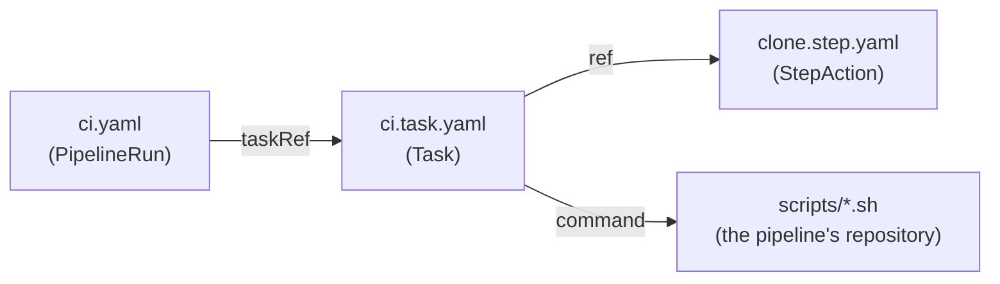

# Short, composed Tekton files

**Decision**: this repository's Tekton files (PipelineRun, Pipeline, Task, StepAction) are short and composed from
references, not long and inlined. A PipelineRun names its Pipeline or Tasks, each in a file of its own beside it, which
Octomaton inlines before it creates the run ([Tekton files](../../octomaton/designs/tekton-files.md)); a step that
Tasks share is a StepAction; a step names its command or runs a script file of the pipeline's own repository. The rule
is in this repository's `CLAUDE.md`, so its reviews hold changes to it. Linear:
[ENG-185](https://linear.app/arikkfir/issue/ENG-185), delivered by
[tooling#57](https://github.com/arikkfir-org/tooling/pull/57).

## Context

- A PipelineRun with an inline `pipelineSpec`, `taskSpec` and step `script`s grows into one long file of YAML wrapping
  shell: `reviewer/pipelinerun.yaml` holds 399 lines, `docs-site/` and `linear/` 126 to 148 each. Its scripts can't be
  linted or run on their own, and a step two pipelines share is copied into both.
- Octomaton resolves `pipelineRef`, `taskRef` and a step's `ref` by name to `<name>.pipeline.yaml`, `<name>.task.yaml`
  and `<name>.step.yaml` beside the PipelineRun file, at the same commit, and inlines them, so the run Tekton gets is
  the same as an inlined one.
- Octomaton's CI cache split its `ci` and `main` that way first
  ([octomaton#54](https://github.com/arikkfir-org/octomaton/pull/54)).

## Design

| Concern | How |
| --- | --- |
| PipelineRun | Its run's settings only: ServiceAccount, timeouts, `taskRunSpecs`, workspaces, params, and the Pipeline or Tasks it runs, by reference |
| Task | Its steps, its volumes and a `stepTemplate`; a step that another Task also runs is a StepAction, referenced with `ref` |
| Step | Names its command and arguments, or runs a script file. An inline `script` is a few lines of glue at most, such as the clone that fetches the script files |
| Script files | Come from the pipeline's own repository, never from the code under test. A pipeline of this repository's own runs them from its checkout; an organization pipeline runs them from its clone of `tooling`'s default branch, as `reviewer/`, `docs-site/` and `linear/` do, because the repository it runs on, the checkout a pull request controls, must not run code where its tokens and ServiceAccounts are |
| Bounds | Octomaton reads at most 20 files per PipelineRun, by name, in the PipelineRun's directory |

## Decisions

| Decision | Why | Rejected |
| --- | --- | --- |
| Files beside the PipelineRun, by name | Octomaton inlines them at the run's commit, so a pull request's change to a Task runs in its own checks, and an organization pipeline's are read at `main` with its PipelineRun | Cluster Tasks through Tekton's resolvers: Octomaton refuses remote references, and they would change outside review |
| Scripts in files | They can be linted (shellcheck) and run alone | Inline `script`: shell inside YAML, unlinted |
| Existing long files are split when a change touches them | The rule binds new work without a rewrite of every pipeline at once | Splitting them all now: a large change with no other benefit |

## Rollout

1. `CLAUDE.md` states the rule ([tooling#57](https://github.com/arikkfir-org/tooling/pull/57)).
2. This repository's pipelines and the organization pipelines stay as they are until a change touches them, which then
   splits what it touches.
