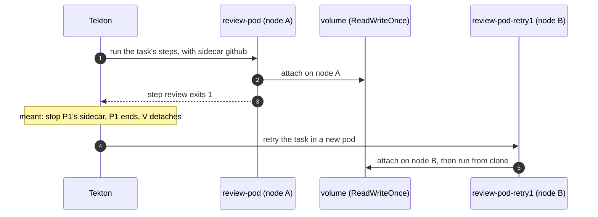

# A failed AI Review never ends: its retry waits for a volume until the run is cancelled

**Status**: 🟡 fixed in the pull request that adds this page; the reviewer runs from `tooling`'s `main`, so its merge deploys it · **Seen in**: check `AI Review`, every repository, the hub's Tekton v1.15.0 · **Since**: the review became one pod with a sidecar and a retry (October 2026) · **Issue**: [ENG-240](https://linear.app/arikkfir/issue/ENG-240)

## 🎯 TL;DR

When a review's pod fails (DeepSeek's "Insufficient Balance" on 2026-11-01), Tekton retries the task in a new pod but never stops the failed pod's `github` sidecar, so the failed pod keeps the run's volume. A retry pod placed on another node waits for that volume until someone cancels the run: the check stays in progress with no review, and the failed pod holds a CI node for over an hour.

## 🧭 How it's meant to work

The review is one pod: six steps and the `github` sidecar, which serves GitHub to the model ([the reviewer](../designs/pr-reviewer.md)). Once a TaskRun is done, Tekton stops its pod's sidecars by swapping their image for a no-op one; the pod ends and its volume detaches. The task retried once, so a failure was meant to run the whole review again in a new pod.

## 💥 Root cause

Tekton stops a pod's sidecars only once its TaskRun is done. A retried attempt is never done: Tekton's TaskRun reconciler (`finishReconcileUpdateEmitEvents` → `retryTaskRun`, v1.15.0) turns the failed condition straight into `ToBeRetried`, clears the pod's name and creates a new pod, so `stopSidecars` never runs on the failed pod. Its `github` sidecar serves on, the pod stays running (1/7 ready), and the run's `ReadWriteOnce` claim stays attached to its node. The fault was the review task's `retries: 1` in `reviewer/pipelinerun.yaml`, which put a sidecar and a shared claim behind Tekton's retry.

## 🔍 Evidence

| Claim | Evidence | Status |
|---|---|---|
| The review step failed on DeepSeek's side | `cobranch-review-4e7e0c8-1-review-pod`, step `review`, 22:53:05Z: `Error: Insufficient Balance` | ✅ |
| Tekton retried in a new pod at once | Event on TaskRun `cobranch-review-4e7e0c8-1-review`, 22:53:09Z: `ToBeRetried "step-review" exited with code 1`; pod `…-review-pod-retry1` scheduled on node `gke-hub-ci-d2857bce-4hft` at 22:53:10Z | ✅ |
| The retry pod waited for the failed pod's volume | Event on `…-review-pod-retry1`, 22:53:10Z: `Waiting for detach for volume "pvc-8aa53e6f-…" Volume is already used by pod(s) cobranch-review-4e7e0c8-1-review-pod` | ✅ |
| It waited until the run was cancelled | Event on the TaskRun, 23:13:24Z: `was cancelled … Previous status: [Pending] pod status "PodReadyToStartContainers":"False"` | ✅ |
| The failed pod's sidecar outlived the run | Event on `cobranch-review-4e7e0c8-1-review-pod`, 2026-11-02 00:00:17Z: `Stopping container sidecar-github`, 67 minutes after the step failed | ✅ |
| Tekton never stops a retried attempt's sidecars | Tekton v1.15.0, `pkg/reconciler/taskrun/taskrun.go`: `stopSidecars` runs only under `tr.IsDone()`; `retryTaskRun` sets the condition to `Unknown` and `PodName` to `""` | ✅ |
| The fix ends a failure at once | Octomaton v0.5.0's renderer (`octomaton-lint -render`) gives the same run as before, `retries: 1` aside: without a retry, a failed attempt is done, and Tekton stops its sidecar | ✅ |

🔎 Every review retry since October

20 review pods were retried since 2026-10-05. The six that hung were those placed on another node than the failed pod, all on 2026-11-01: `delivery-review-5ae6422-1` (20:38Z) and `cobranch-review-` `4e7e0c8-1`, `78f9af6-1`, `6edfd8d-1`, `2766b57-1` and `884a4f8-1` (22:53Z-22:54Z). The other 14 shared the failed pod's node, where a `ReadWriteOnce` claim mounts in both, and ran. Source: Cloud Logging, `logs/events`, `Scheduled` and `Volume is already used by pod` on `*-review-pod-retry1`.

## 🌍 Blast radius

Every repository's AI Review. A failed review whose retry landed on another node hung until cancelled or the run's hour ran out; one that shared the node ran again, at the cost of a second model run that an outage fails the same way. Either way the failed pod kept running, its requests reserved on a CI node, until its run was deleted. Six reviews hung on 2026-11-01, five of them in `cobranch` during the DeepSeek outage.

## 🩺 Still on `main`?

🟡 Fixed in the pull request that adds this page, not merged yet: the review task no longer retries, and Octomaton reruns a review whose pod the cluster took away (`disruptions: {reruns: 1}` on pipeline `review`), as a new run with a volume of its own. `main` before it retries once.

## 📊 Confidence

High: the events show the retry pod waiting on the failed pod's claim, and Tekton's code shows why the failed pod never stops.

## 🏁 Outcome

[ENG-240](https://linear.app/arikkfir/issue/ENG-240): the task doesn't retry, so a failure ends the run at once with its error on the check, and Octomaton's disruption reruns cover a lost node. Other pipelines that retry a task with a sidecar leave the failed attempt's sidecar running the same way, though without a shared claim their retry isn't blocked.
